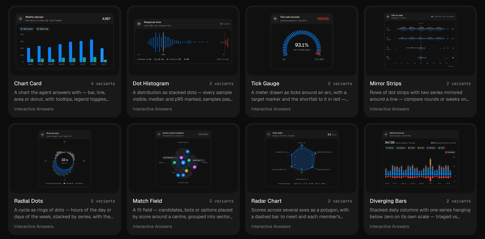

<p align="center">
  <a href="https://tuffui.com">
    
  </a>
</p>

<h1 align="center">TUFFUI</h1>

<p align="center">
  Free, MIT-licensed React components for AI chat and agent interfaces.
  <br>
  <a href="https://tuffui.com"><strong>tuffui.com</strong></a>
  ·
  <a href="https://tuffui.com/components">Components</a>
  ·
  <a href="https://tuffui.com/docs/installation">Installation</a>
</p>

<p align="center">
  <a href="https://tuffui.com/components">
    
  </a>
</p>

76 components for the parts of AI products generic UI kits don't cover: tool-call
approvals, agent plans and traces, streaming chat, memory, usage meters, charts for
agent data, and full screens built from them. They are distributed as a shadcn
registry, so installing one copies its source into your project:

```bash
npx shadcn@latest add https://tuffui.com/r/tool-approval-queue.json
```

No Pro tier, no signup, nothing locked.

## Develop

```bash
pnpm install
pnpm dev               # http://localhost:3000
pnpm build             # registry build (public/r) + next build
pnpm lint && pnpm typecheck && pnpm format:check
```

## Layout

| Path                         | What                                                                                                     |
| ---------------------------- | -------------------------------------------------------------------------------------------------------- |
| `registry/<name>/`           | Components: the single source of truth. `demo.tsx` and `docs.ts` hold each component's preview and docs. |
| `registry/use-mock-run/`     | Scripted runs that drive every preview. No component depends on it.                                      |
| `lib/catalog.ts`             | Component metadata: names, categories, variants.                                                         |
| `lib/site.ts`                | Brand values: name, URL, GitHub.                                                                         |
| `app/globals.css`            | Theme tokens. The registry `theme` item is generated from this file.                                     |
| `scripts/build-registry.mts` | Writes `registry.json`, then runs `shadcn build` into `public/r/`.                                       |

## Add a component

1. Create `registry/<slug>/<slug>.tsx`, `demo.tsx` and `docs.ts`.
2. Add an entry to `lib/catalog.ts`.
3. Import shared primitives as `@/components/ui/<name>` and motion values from
   `@/lib/motion-tokens`. The registry build reads each file's imports and fills in npm
   and registry dependencies on its own.
4. Register the demo in `components/docs/demo.tsx` and the docs in `lib/docs/index.ts`.

## Add a screen

Screens are whole app screens composed from components (shadcn `registry:block`). They
preview in a device frame (1280 / 768 / 390) on `/components/<slug>` and render alone at
`/screens/<slug>`.

1. Same files as a component: `registry/<slug>/<slug>.tsx`, `demo.tsx`, `docs.ts`, a
   catalog entry with `category: "screens"`, and the demo/docs registrations.
2. Import components only as `@/components/ui/<slug>` (shims exist for all of them).
   Dependencies are read from the screen file and its demo, so the components the demo
   renders as content come along on install.
3. The root fills its parent (`h-full w-full`) and is a `@container`. Lay out with
   container queries (`@md:`, `@4xl:` …), never viewport breakpoints, so each device width
   in the frame shows its own layout.
4. Scrolling: one vertical scroll for the main content (the thread). No nested scroll
   areas inside messages or panels. A composer stays pinned at the bottom over the
   content — `ChatThread bare` with `bottomInset` set to the composer's measured height.
   A sidebar may scroll only when it is taller than the screen.
5. Nothing scrolls sideways at any width: chips and tags wrap, long text truncates or
   wraps, payloads wrap. Overlays (drawers) stay inside the screen instead of portalling
   to the page. Check: no element with `overflow-x: auto | scroll` and
   `scrollWidth > clientWidth`, and nothing visible outside the screen box.

## Deploy

The site is a fully static export: `pnpm build` writes every page, the registry JSON
(`/r/*.json`), `llms.txt` and the OG images to `out/`, plus `out/_headers` with content
types and cache rules. Any static host works; Cloudflare serves static assets with no
bandwidth or request charges, which keeps heavy registry traffic free.

### Cloudflare (recommended)

1. Registry install URLs, `registryDependencies`, OG images and `llms.txt` are built from
   the site URL, which defaults to `https://tuffui.com` (override with `NEXT_PUBLIC_SITE_URL`):
   `pnpm cf:deploy`
   This builds and runs `wrangler deploy` with `wrangler.jsonc` (Workers static assets,
   no Worker script). The first run asks you to log in to Cloudflare.
2. Or connect the GitHub repo in the Cloudflare dashboard (Workers & Pages → Create →
   import a repository), with build command `pnpm build`, output directory `out`, and
   `NEXT_PUBLIC_SITE_URL` set under build variables.
3. Add the `tuffui.com` custom domain and redeploy.

### Preview locally

`pnpm build && pnpm start` serves `out/` at http://localhost:3000.

### Other hosts

Upload `out/` to Vercel, Netlify, GitHub Pages or S3 + CloudFront. Only Cloudflare reads
`_headers`; elsewhere set `Content-Type: image/png` for `*/opengraph-image*` and
`application/json` for `/source/*` in the host's config.
